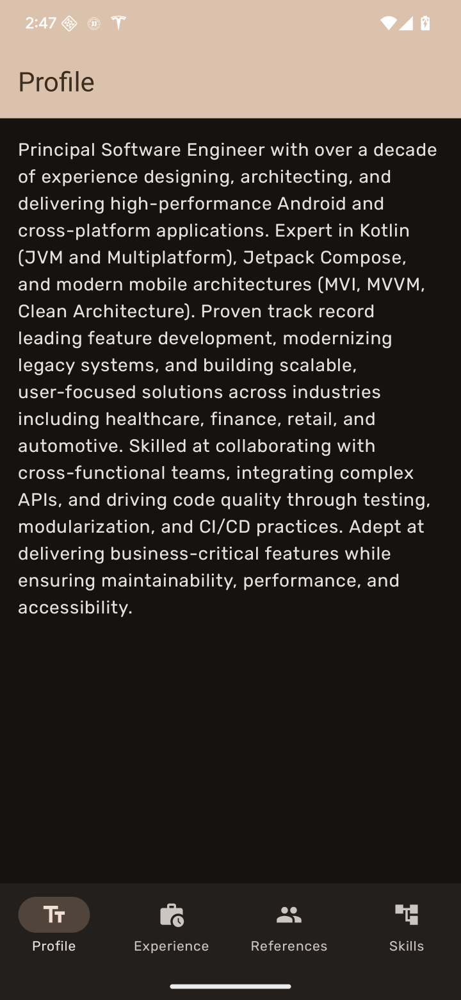
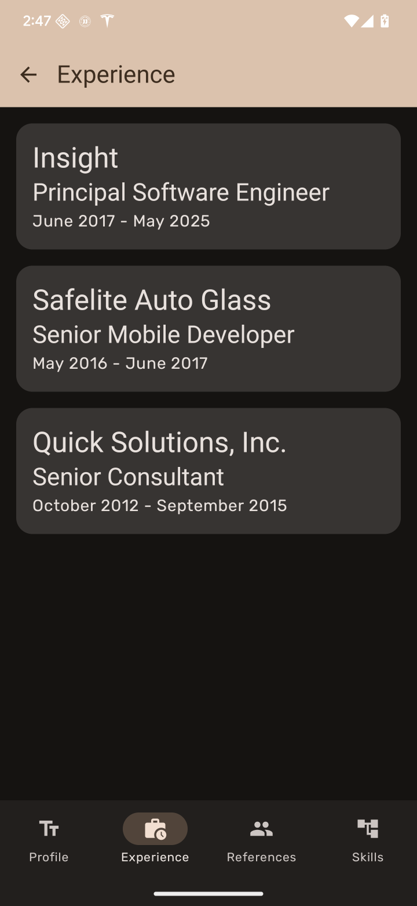
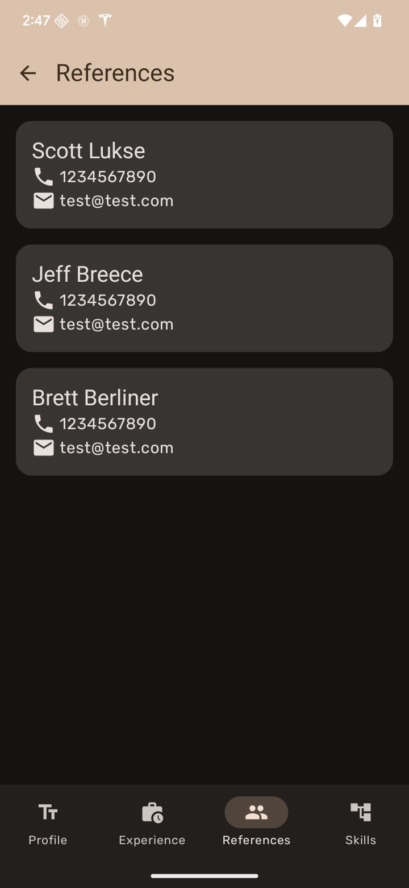
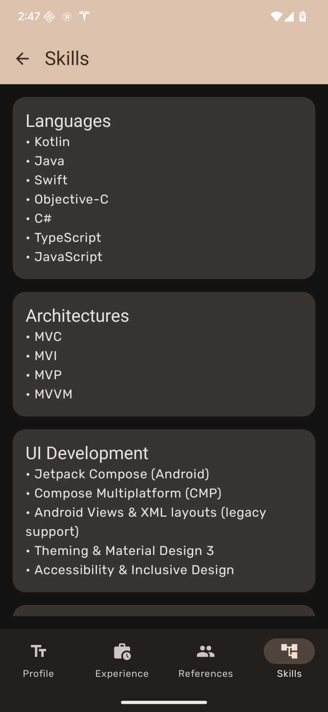
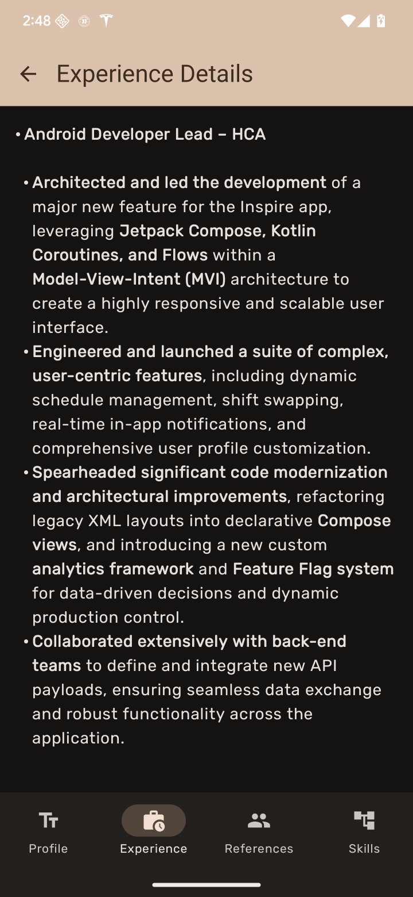

# My Resume App

This project is an Android application to showcase my resume, including my professional profile, work experience, skills, and references. It is designed to demonstrate my skills in modern Android development.

## Screenshots
Screenshots: 
  
  
  
  
  

## Features
- Displays a professional profile.
- Lists work experience.
- Shows a list of skills.
- Presents references.
- Caches data for offline viewing.

## Technical Skills Showcased
- **UI:** Jetpack Compose for building a modern, declarative UI.
- **Architecture:** Model-View-Intent (MVI) for a clean and scalable architecture.
- **Dependency Injection:** Dagger Hilt for managing dependencies.
- **Asynchronous Programming:** Kotlin Coroutines and Flow for managing background tasks and handling asynchronous data streams.
- **Networking:** Ktor Client for efficient and modern network communication.
- **Data Persistence:** Room Database for local caching of data.
- **Data Handling:**
    - Repository pattern to abstract data sources.
    - Custom `Result` wrapper for robust error handling.
    - Data mapping between network, database, and domain layers.
- **State Management:** `StateFlow` in ViewModels to expose UI state to Composables.

## Architecture
This app follows the Model-View-Intent (MVI) architecture, which is recommended by Google for modern Android development.

- **View (UI Layer):** Built with Jetpack Compose. The UI observes state changes from the ViewModel using `StateFlow` and updates itself accordingly.
- **ViewModel:** The ViewModels (`ProfileViewModel`, etc.) are responsible for preparing and managing the data for the UI. They fetch data from the repository and expose it to the UI as state.
- **Repository:** The `ResumeRepository` acts as a single source of truth for the app's data. It fetches data from the network (using Ktor) and caches it in a local Room database.
- **Model:** The data is represented by Kotlin data classes, with separate models for the network responses, database entities, and domain layer.

This architecture promotes separation of concerns, making the app more testable, maintainable, and scalable.
